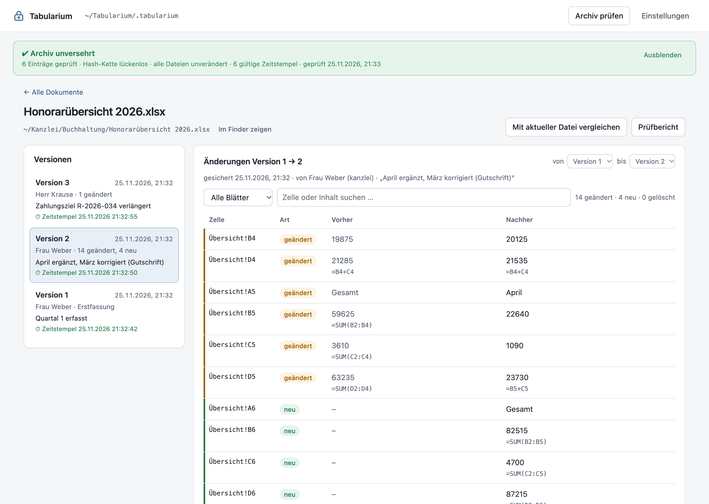
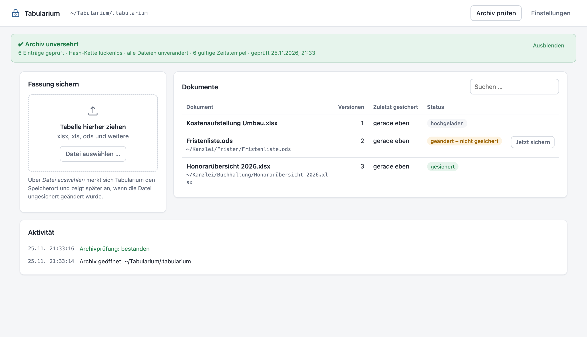
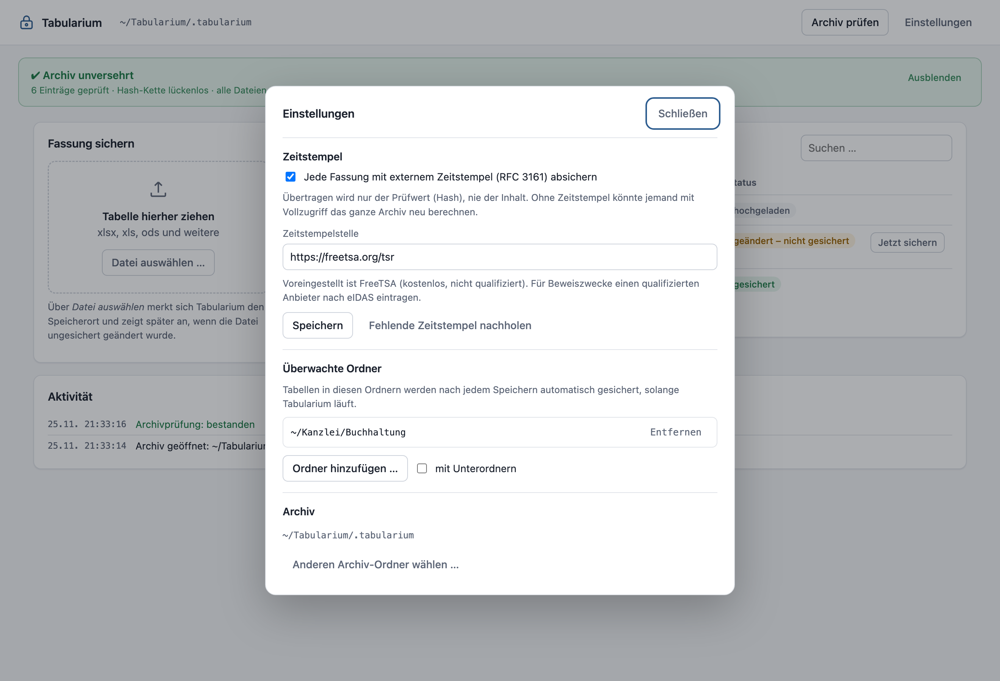
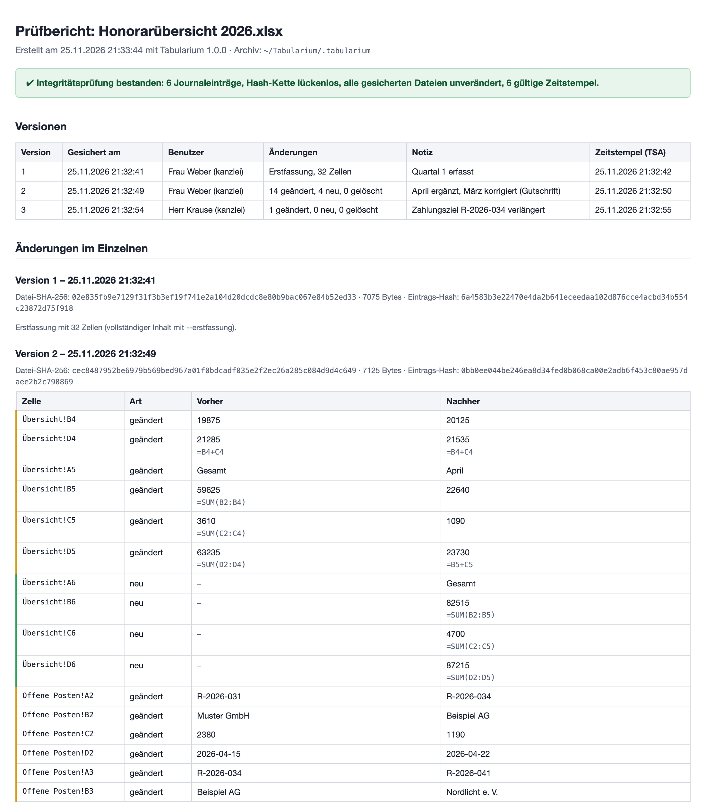
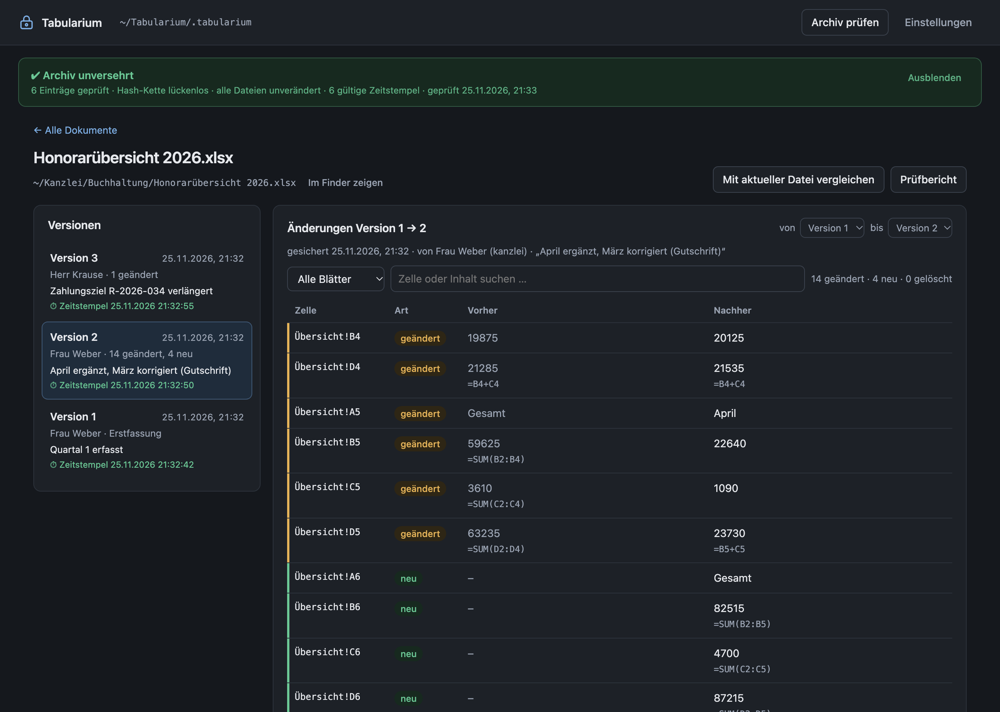
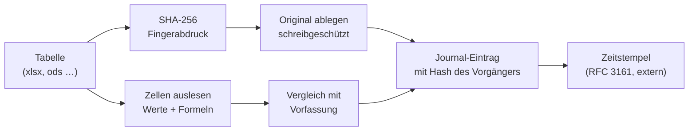

# Tabularium

[](https://github.com/PBaumfalk/Tabularium/actions/workflows/tests.yml)
[](LICENSE)
[](https://www.python.org)
[](#für-entwickler)

**Excel- und LibreOffice-Tabellen revisionssicher ablegen: jede Fassung, jede
geänderte Zelle, nachweisbar unverändert.**
Tabularium ist ein kostenloses Archiv für Tabellenkalkulationen in Kanzleien,
Unternehmen und Verwaltungen. Sie legen eine Tabelle hinein, und Tabularium
bewahrt jede Fassung unverändert auf. Es zeigt Zelle für Zelle, was sich
zwischen zwei Fassungen geändert hat, mit Werten und Formeln. Ein Prüfbericht
belegt, dass seit dem Sichern nichts mehr verändert wurde.

Blattschutz und Kennwörter in Excel lassen sich in Sekunden entfernen.
Tabularium setzt deshalb außerhalb der Datei an. Jede Fassung erhält einen
kryptografischen Fingerabdruck (SHA-256). Alle Fassungen sind in einer
lückenlosen Kette verbunden, und auf Wunsch bestätigt eine externe
Zeitstempelstelle den Zeitpunkt jeder Fassung. Wer nachträglich auch nur ein
Byte ändert, eine Fassung löscht oder eine einschiebt, fällt bei der Prüfung
auf.

Tabularium läuft auf Ihrem eigenen Mac und braucht keine Cloud, kein Abo und
kein Zusatzpaket. An die Zeitstempelstelle geht nur der Fingerabdruck, nie der
Inhalt Ihrer Tabellen.

*Tabularium* hieß das Staatsarchiv des antiken Rom am Kapitol. Dort lagen die
amtlichen Tafeln (*tabulae*), unverändert und für jeden nachprüfbar. Genau das
leistet Tabularium für Ihre Tabellen.

> **English abstract:** Tamper-evident archive for spreadsheets (xlsx, xlsm, ods,
> fods, xls via LibreOffice). Every saved version is stored byte-for-byte under its
> SHA-256, its cell contents (values and formulas) are extracted and diffed
> against the previous version, and all events are recorded in an append-only,
> hash-chained journal. Optional RFC 3161 timestamps from an external TSA anchor
> each entry. It offers a local web UI (drag & drop, version history, cell-level
> diff, folder watching, printable audit report) and a CLI. It is written in pure
> Python 3.8+ with the standard library only, and the archive can be verified
> independently with `shasum`, `openssl` and a few lines of Python. The UI and
> documentation are in German.



## 📖 Handbuch

Die vollständige Anleitung steht im **[Handbuch](docs/handbuch/README.md)**. Sie
ist verständlich für Mitarbeitende ohne IT-Kenntnisse und hat eigene Kapitel
für die IT. Sie reicht von den [Grundbegriffen](docs/handbuch/01-was-ist-tabularium.md)
über die [erste gesicherte Fassung](docs/handbuch/03-erste-fassung.md) und den
[Zellvergleich](docs/handbuch/04-verlauf-und-vergleich.md) bis zum
[Prüfbericht](docs/handbuch/06-pruefen-und-pruefbericht.md) und zur
[Prüfung ohne Tabularium](docs/handbuch/11-unabhaengig-pruefen.md), etwa durch
Gutachter oder Betriebsprüfer.

## Installation

Tabularium braucht nur **Python 3.8 oder neuer**, das auf dem Mac in der Regel
schon vorhanden ist. Weitere Pakete sind nicht nötig. Für alte `.xls`-Dateien
wird zusätzlich das kostenlose [LibreOffice](https://de.libreoffice.org)
verwendet.

<details>
<summary><strong>🍎 Auf dem Mac</strong> (ohne IT-Kenntnisse)</summary>

1. Auf dieser Seite oben auf **Code → Download ZIP** klicken und die ZIP-Datei
   entpacken, zum Beispiel in den Ordner *Programme* oder *Dokumente*.
2. Im entpackten Ordner doppelt auf **`Tabularium.command`** klicken.
   - Meldet macOS, dass die Datei von einem nicht verifizierten Entwickler stammt:
     mit der rechten Maustaste auf die Datei klicken, **Öffnen** wählen und
     bestätigen. Das ist nur beim ersten Mal nötig.
   - Fragt macOS nach den *Befehlszeilenentwicklerwerkzeugen*: **Installieren**
     klicken, warten, dann erneut doppelklicken. Das installiert Python.
3. Es öffnet sich ein Terminalfenster, das Sie offen lassen, und Tabularium im
   Browser. Fertig.

Ihr Archiv liegt dann im Ordner **Tabularium** in Ihrem Benutzerordner.
Ausführlich: [Handbuch, Kapitel 2](docs/handbuch/02-installation.md).
</details>

<details>
<summary><strong>🐧 Linux und Kommandozeile</strong> (für IT)</summary>

```bash
git clone https://github.com/PBaumfalk/Tabularium.git
cd Tabularium
./tabularium web                         # Weboberfläche auf http://127.0.0.1:8765
./tabularium einchecken Liste.xlsx -n "Stand nach Prüfung"
./tabularium pruefen
```

Die Weboberfläche ist nur von diesem Rechner aus erreichbar (127.0.0.1). Unter
Linux fehlen die Mac-Dateidialoge und die Dateisperren (`chflags`); Dateien
ziehen Sie dort in das Ablagefeld. Windows wird derzeit nicht unterstützt.
Alle Befehle: [Kapitel 9](docs/handbuch/09-kommandozeile.md).
</details>

## Funktionen im Überblick

| Übersicht mit Status jeder Datei | Einstellungen |
| --- | --- |
|  |  |

- **Fassungen sichern** per Ziehen und Ablegen oder über den Mac-Dateidialog,
  mit Notiz und Namen der bearbeitenden Person
  ([Kapitel 3](docs/handbuch/03-erste-fassung.md))
- **Zellvergleich:** Was ist neu, geändert, gelöscht? Mit Vorher und Nachher,
  Formeln, Filter nach Blatt und Suche. Zwei beliebige Fassungen lassen sich
  vergleichen, ebenso die aktuelle Datei mit der letzten Sicherung
  ([Kapitel 4](docs/handbuch/04-verlauf-und-vergleich.md))
- **„Geändert – nicht gesichert“:** Tabularium merkt sich den Speicherort und
  zeigt an, wenn eine Datei seit der letzten Sicherung verändert wurde
- **Ordner überwachen:** Jede gespeicherte Änderung wird automatisch gesichert
  ([Kapitel 5](docs/handbuch/05-ordner-ueberwachen.md))
- **Archiv prüfen und Prüfbericht:** grün oder rot auf einen Blick. Der
  druckfertige Bericht für die Akte enthält alle Fassungen, Änderungen,
  Prüfwerte und Zeitstempel
  ([Kapitel 6](docs/handbuch/06-pruefen-und-pruefbericht.md))
- **Externe Zeitstempel** nach RFC 3161, wahlweise von einem qualifizierten
  Vertrauensdiensteanbieter nach eIDAS ([Kapitel 7](docs/handbuch/07-zeitstempel.md))
- **Jede Fassung zurückholen**, byte-genau wie damals gespeichert
  ([Kapitel 8](docs/handbuch/08-wiederherstellen.md))
- **Formate:** xlsx, xlsm, xltx, xltm, ods, ots, fods und mit LibreOffice auch
  xls, xlsb, xlt. Verschlüsselte oder beschädigte Dateien werden trotzdem
  gesichert
- **Kommandozeile** für Skripte und Automatisierung
  ([Kapitel 9](docs/handbuch/09-kommandozeile.md))
- **Hell und dunkel**, folgt der Systemeinstellung

| Prüfbericht für die Akte | Dunkler Modus |
| --- | --- |
|  |  |

## So funktioniert die Absicherung



1. **Das Original bleibt unverändert.** Jede Fassung wird byte-genau unter ihrem
   SHA-256-Wert abgelegt. Sie ist schreibgeschützt und auf dem Mac zusätzlich
   gegen Ändern und Löschen gesperrt.
2. **Die Zellen werden lesbar gemacht.** Tabularium liest Werte und Formeln
   aller Blätter aus und vergleicht sie mit der Vorfassung.
3. **Alle Einträge bilden eine Kette.** Jeder Eintrag im Journal enthält den
   Fingerabdruck seines Vorgängers. Wer einen Eintrag ändert, löscht oder
   einschiebt, bricht die Kette.
4. **Ein Zeitstempel sichert die Kette nach außen ab.** Eine externe
   Zeitstempelstelle bestätigt, dass ein Eintrag und damit die ganze Kette bis
   dorthin zu diesem Zeitpunkt existierte. Erst damit hilft es nichts mehr, das
   Archiv mit Vollzugriff einfach neu zu berechnen.

**Prüfbar ohne Tabularium:** Das Archiv besteht aus gewöhnlichen Dateien. Ein
Gutachter kann es mit `shasum`, `openssl` und einem kurzen Python-Skript
unabhängig prüfen ([Kapitel 11](docs/handbuch/11-unabhaengig-pruefen.md)).

## Datenschutz und Sicherheit

- Keine Telemetrie und keine Cloud. Ihre Tabellen verlassen den Rechner nicht.
- Für einen Zeitstempel wird nur ein Fingerabdruck (64 Zeichen) übertragen. Aus
  ihm lässt sich nichts über den Inhalt ablesen. Zeitstempel sind
  standardmäßig ausgeschaltet.
- Die Weboberfläche lauscht nur auf `127.0.0.1`. Sie verlangt ein
  Sitzungstoken, prüft den `Host`-Header gegen DNS-Rebinding und setzt eine
  strenge Content-Security-Policy. Zellinhalte werden nie als HTML
  eingesetzt.
- Tabularium ändert Ihre Tabellen nie. Es liest sie nur.

## Was Tabularium nicht leistet

Ehrliche Grenzen: Wer eine Änderung vorgenommen hat, weiß Tabularium nur über
das Benutzerkonto bzw. die Angabe „Bearbeitet von“. Gegen das Löschen des
ganzen Archivs schützt nur eine Kopie auf unveränderbarem Speicher (WORM).
Verglichen werden Werte und Formeln, nicht Formatierung, Kommentare oder
Makros. Eine eingefügte Zeile erscheint als Änderung der darunter liegenden
Zellen. Für Unterlagen nach GoBD gehört eine Verfahrensdokumentation dazu.
Einzelheiten: [Kapitel 13](docs/handbuch/13-grenzen-und-recht.md).

## Für Entwickler

Reines Python ab 3.8, nur die Standardbibliothek, kein Build-Schritt. Den
Aufbau und das Archivformat beschreibt [Kapitel 12](docs/handbuch/12-technik.md).

| Datei | Inhalt |
| --- | --- |
| [`tabularium.py`](tabularium.py) | Kern und Kommandozeile: Auslesen (xlsx/ods), Vergleich, Archiv, Journal, Zeitstempel, Prüfbericht |
| [`tabularium_web.py`](tabularium_web.py) | Lokaler Webserver mit JSON-API und Ordnerüberwachung |
| [`web/`](web) | Oberfläche: HTML, CSS, Vanilla-JavaScript, ohne Framework |
| [`tests/`](tests) | Unit- und Integrationstests, darunter Manipulationsversuche und die Sicherheit der API |

```
python3 -m unittest discover tests -v
```

Die Tests laufen in GitHub Actions auf macOS und Linux. Ist LibreOffice
installiert, prüfen sie zusätzlich, dass ods, xlsx und xls dasselbe
Zellabbild liefern. Änderungen stehen im [Änderungsprotokoll](CHANGELOG.md).

## Lizenz

[MIT](LICENSE), © 2026 Patrick Baumfalk.

## Haftungsausschluss

Tabularium unterstützt bei der nachvollziehbaren Ablage von Tabellen. Es ist
keine Rechts- oder Steuerberatung, und es ist kein zertifiziertes
Archivsystem. Ob eine Ablage den Anforderungen etwa der GoBD, der
Abgabenordnung oder einer Aufbewahrungspflicht genügt, hängt auch von
organisatorischen Maßnahmen ab: Zugriffsrechte, Verfahrensdokumentation,
Datensicherung. Die Beweiskraft eines Zeitstempels hängt vom gewählten
Anbieter ab. Für Folgen fehlerhafter oder unvollständiger Ablage wird keine
Gewähr übernommen.
