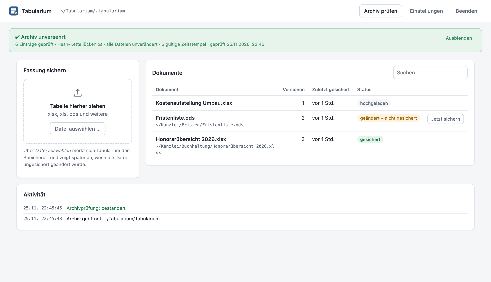

# 3 — Die erste Fassung sichern

In diesem Kapitel bringen Sie eine Tabelle ins Archiv. Das dauert etwa 30
Sekunden.

## Schritt für Schritt

1. Tabularium starten ([Kapitel 2](02-installation.md)).
2. Die Tabelle auswählen. Dafür gibt es zwei Wege:
   - **Datei auswählen …** öffnet den Dateidialog von macOS bzw. Windows. Sie
     können mehrere Dateien auf einmal wählen (⌘ bzw. Strg gedrückt halten).
   - **Hineinziehen:** Die Datei aus dem Finder in das gestrichelte Feld ziehen.
3. Die Datei erscheint unter dem Feld. Tragen Sie eine **Notiz** ein, die
   erklärt, warum Sie diesen Stand sichern, zum Beispiel „Monatsabschluss
   Oktober“ oder „Stand vor Versand an Mandant“.
4. Unter **Bearbeitet von** Ihren Namen eintragen. Tabularium merkt sich den
   Namen für das nächste Mal.
5. **Sichern** klicken (oder Enter im Notizfeld).

Unten erscheint eine Meldung wie *„Honorarübersicht 2026.xlsx: Version 1
gesichert (Erstfassung)“*, und das Dokument steht in der Liste rechts.

## Welcher Weg ist besser?

| | Datei auswählen … | Hineinziehen |
| --- | --- | --- |
| Tabularium merkt sich den Speicherort | ✔ | – |
| Anzeige „geändert – nicht gesichert“ | ✔ | – |
| „Jetzt sichern“ mit einem Klick | ✔ | – |
| „Mit aktueller Datei vergleichen“ | ✔ | – |
| Funktioniert ohne Systemdialog (z. B. Linux ohne zenity) | – | ✔ |

Browser verraten aus Datenschutzgründen nicht, wo eine hineingezogene Datei
liegt. Tabularium sichert sie trotzdem vollständig, kann sie aber später nicht
wiederfinden. Für Tabellen, die Sie regelmäßig sichern, nehmen Sie deshalb
**Datei auswählen …**.

## Die Dokumentliste

Jedes Dokument zeigt die Anzahl der Fassungen, den Zeitpunkt der letzten
Sicherung und einen **Status**:

| Status | Bedeutung |
| --- | --- |
| <kbd>gesichert</kbd> | Die Datei am Speicherort ist genau die zuletzt gesicherte Fassung. |
| <kbd>geändert – nicht gesichert</kbd> | Die Datei wurde seit der letzten Sicherung verändert. Mit **Jetzt sichern** legen Sie eine neue Fassung an. Dabei werden Notiz und Name aus dem Feld links übernommen. |
| <kbd>Datei nicht am Ort</kbd> | Die Datei wurde verschoben, umbenannt oder gelöscht. Die gesicherten Fassungen sind davon nicht betroffen. |
| <kbd>hochgeladen</kbd> | Die Datei wurde hineingezogen. Ihr Speicherort ist unbekannt. |

Die Liste aktualisiert sich alle fünf Sekunden von selbst. Über das Suchfeld
filtern Sie nach Namen oder Speicherort.

## Was beim Sichern passiert

1. Tabularium berechnet den Fingerabdruck der Datei. Hat sich nichts geändert
   seit der letzten Fassung, meldet es *„unverändert – bereits gesichert“* und
   legt keine neue Fassung an.
2. Die Datei wird byte-genau ins Archiv kopiert und dort schreibgeschützt.
3. Tabularium liest alle Zellen aus und vergleicht sie mit der Vorfassung.
4. Ein Eintrag wird ans Journal angehängt, verkettet mit dem vorigen.
5. Sind Zeitstempel eingeschaltet, holt Tabularium den Zeitstempel
   ([Kapitel 7](07-zeitstempel.md)).

Ihre Originaldatei wird dabei nur gelesen, nie verändert.

## Unterstützte Formate

| Format | Endungen | Hinweis |
| --- | --- | --- |
| Excel | `.xlsx`, `.xlsm`, `.xltx`, `.xltm` | direkt |
| LibreOffice / OpenDocument | `.ods`, `.ots`, `.fods` | direkt |
| Altes Excel | `.xls`, `.xlsb`, `.xlt` | über LibreOffice, das installiert sein muss |

**Verschlüsselte Dateien** (mit Kennwort zum Öffnen) und beschädigte Dateien
sichert Tabularium trotzdem. Es meldet dann *„Zellinhalt nicht lesbar“*. Die
Originaldatei ist vollständig gesichert und geprüft, nur der Zellvergleich
fehlt.

## Gute Gewohnheiten

- **Eine Notiz bei jeder Fassung.** In einem Jahr wissen Sie sonst nicht mehr,
  warum es diesen Stand gab.
- **Vor dem Versenden sichern.** Geht eine Tabelle an Mandanten, Gericht,
  Steuerberatung oder Behörde, sichern Sie genau diesen Stand.
- **Ordnerüberwachung für Listen, die täglich wachsen**, etwa Fristen- oder
  Zeitlisten ([Kapitel 5](05-ordner-ueberwachen.md)).

---

← [2 — Installation](02-installation.md) | [Inhalt](README.md) | [4 — Verlauf und Zellvergleich](04-verlauf-und-vergleich.md) →
