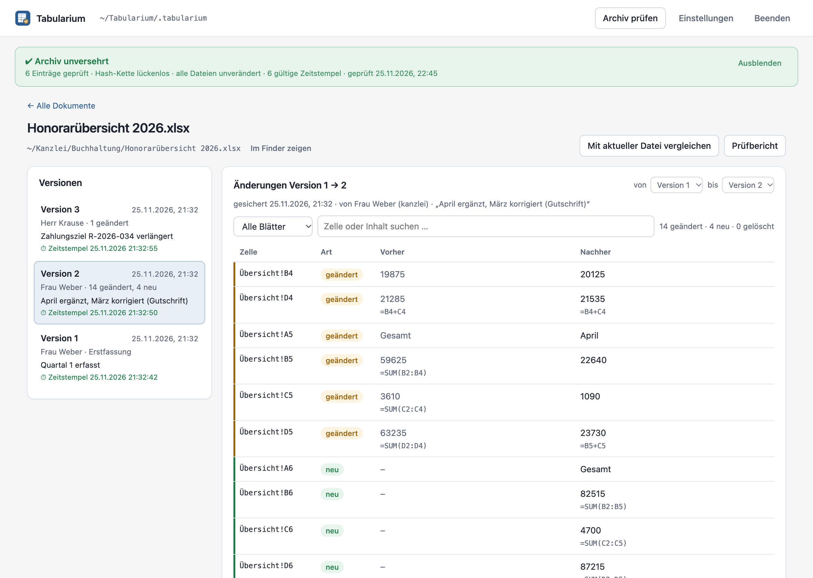

# 4 — Verlauf und Zellvergleich

Ein Klick auf ein Dokument in der Liste öffnet seinen **Verlauf**. Links stehen
alle Fassungen, rechts die Änderungen der gewählten Fassung gegenüber ihrer
Vorgängerin.

## Die Versionsliste

Die neueste Fassung steht oben. Zu jeder Fassung sehen Sie:

- **Version und Zeitpunkt** der Sicherung
- **wer** gesichert hat (die Angabe „Bearbeitet von“, sonst das Benutzerkonto)
- **was** sich geändert hat, zum Beispiel „14 geändert, 4 neu“
- die **Notiz**
- ⏱ den **Zeitstempel**, falls vorhanden ([Kapitel 7](07-zeitstempel.md))

Ein Klick auf eine Fassung zeigt rechts ihre Änderungen.

## Der Zellvergleich

Jede Zeile der Tabelle ist eine geänderte Zelle:

| Spalte | Inhalt |
| --- | --- |
| **Zelle** | Blatt und Zelladresse, z. B. `Übersicht!B4` |
| **Art** | <kbd>neu</kbd> (grün): Die Zelle war vorher leer. <kbd>geändert</kbd> (gelb): Wert oder Formel hat sich geändert. <kbd>gelöscht</kbd> (rot): Die Zelle ist jetzt leer. |
| **Vorher / Nachher** | Der Wert und darunter in grauer Schrift die Formel, falls die Zelle eine hat |

Zahlen erscheinen mit Dezimalkomma, Datumsangaben als TT.MM.JJJJ. Fahren Sie
mit der Maus über einen Wert, zeigt Tabularium den exakt gespeicherten Rohwert
(etwa `892.5` oder `2026-04-22`).

Über der Tabelle stehen der Zeitpunkt, die Person und die Notiz der gewählten
Fassung. Rechts sehen Sie die Summe, etwa „14 geändert · 4 neu · 0 gelöscht“.

### Filtern und suchen

- **Blatt:** Hat die Tabelle mehrere Blätter mit Änderungen, wählen Sie hier ein
  Blatt aus.
- **Suchen:** Durchsucht Zelladressen, Werte und Formeln. „R-2026“ findet zum
  Beispiel alle Zellen mit Rechnungsnummern.

### Formeln

Tabularium vergleicht **Werte und Formeln**. Ändert jemand nur eine Formel,
etwa `=SUM(B2:B4)` zu `=SUM(B2:B3)`, und das Ergebnis bleibt zufällig gleich,
erscheint die Zelle trotzdem als geändert. Gerade solche stillen Änderungen
übersieht man sonst leicht.

Formeln stehen so, wie das Programm sie speichert: aus Excel-Dateien in der
englischen Schreibweise (`SUM`, `IF`, Kommas als Trenner), aus
LibreOffice-Dateien mit Punkt vor den Bezügen (`SUM([.B2:.B3])`).

## Zwei beliebige Fassungen vergleichen

Oben rechts stehen zwei Auswahlfelder: **von** und **bis**. Wählen Sie zum
Beispiel *von Version 1 bis Version 5*, sehen Sie alle Änderungen über vier
Fassungen hinweg zusammengefasst. Was zwischendurch geändert und wieder
zurückgeändert wurde, erscheint dabei nicht.

Wählen Sie bei **von** den Strich „–“, zeigt Tabularium den **vollständigen
Inhalt** der Fassung bei **bis**. Alle Zellen erscheinen dann als neu.

## Mit der aktuellen Datei vergleichen

Haben Sie die Datei über **Datei auswählen …** gesichert, gibt es oben den Knopf
**Mit aktueller Datei vergleichen**. Er zeigt, was sich in der Datei am
Speicherort seit der letzten Sicherung geändert hat, ohne eine neue Fassung
anzulegen. So prüfen Sie vor dem Sichern, ob die Änderungen stimmen.

## Warum erscheinen so viele Änderungen?

Tabularium vergleicht **Zelle für Zelle nach Adresse**. Fügt jemand eine Zeile
ein, rutschen alle Zellen darunter eine Zeile nach unten. Für Tabularium hat
sich dann jede dieser Zellen geändert, denn in `A5` steht jetzt, was vorher in
`A4` stand.

Im Bild oben ist genau das passiert: In der Honorarübersicht kam die Zeile
„April“ hinzu. Die Zeile „Gesamt“ rutschte von Zeile 5 nach Zeile 6. Deshalb
erscheint `A5` als geändert (Gesamt → April) und `A6` als neu (Gesamt).

Das ist kein Fehler, sondern die genaue Sicht auf die Zellen. Der Vergleich
zeigt jede Adresse, deren Inhalt sich geändert hat. Wenn Sie eine Zeile
suchen, hilft das Suchfeld.

## Weitere Knöpfe

| Knopf | Wirkung |
| --- | --- |
| **Im Finder zeigen** bzw. **Im Explorer zeigen** | Öffnet den Speicherort der Originaldatei (nur bei „Datei auswählen …“) |
| **Prüfbericht** | Öffnet den Bericht für dieses Dokument in einem neuen Tab ([Kapitel 6](06-pruefen-und-pruefbericht.md)) |
| **Diese Fassung herunterladen** | Lädt die gewählte Fassung byte-genau herunter ([Kapitel 8](08-wiederherstellen.md)) |

Unten rechts steht der **SHA-256-Fingerabdruck** der gewählten Fassung. Mit
ihm lässt sich eine heruntergeladene oder anderswo aufgetauchte Datei
eindeutig zuordnen ([Kapitel 11](11-unabhaengig-pruefen.md)).

> **Direktlink:** Die Adresse `http://127.0.0.1:8765/#/dok/Fristenliste.ods/2`
> öffnet direkt Version 2 der Fristenliste. Ein Lesezeichen darauf spart Klicks.

---

← [3 — Die erste Fassung sichern](03-erste-fassung.md) | [Inhalt](README.md) | [5 — Ordner überwachen](05-ordner-ueberwachen.md) →
