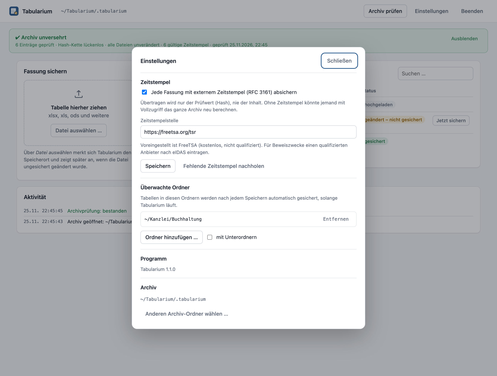

# 5 — Ordner überwachen

Bei Tabellen, an denen täglich gearbeitet wird, vergisst man das Sichern
leicht. Tabularium kann deshalb **Ordner überwachen**: Jede Tabelle darin wird
nach dem Speichern automatisch als neue Fassung gesichert.

## Einrichten

1. Oben rechts auf **Einstellungen** klicken.
2. Unter **Überwachte Ordner** auf **Ordner hinzufügen …** klicken und den Ordner
   wählen, zum Beispiel *Kanzlei/Fristen*.
3. Sollen auch Unterordner überwacht werden, vorher **mit Unterordnern**
   ankreuzen.



Ab jetzt prüft Tabularium alle drei Sekunden, ob sich eine Tabelle im Ordner
geändert hat. Wurde eine Datei gespeichert und ist sie danach mindestens drei
Sekunden lang unverändert, sichert Tabularium sie. Die Notiz lautet dann
*„automatisch (Ordnerüberwachung)“*. In der **Aktivität** auf der Startseite
erscheint eine Zeile wie:

```
25.11. 14:02:18  ✔ Fristenliste.ods – Version 7 gesichert (1 geändert, 0 neu, 0 gelöscht)
```

Beim Einrichten sichert Tabularium alle Tabellen im Ordner, die es noch nicht
kennt oder die sich seit der letzten Fassung geändert haben.

## Gut zu wissen

- **Nur solange Tabularium läuft.** Ist Tabularium beendet, wird nichts
  gesichert. Beim nächsten Start holt es Änderungen nach, aber nur den dann
  aktuellen Stand, nicht jede Zwischenstufe. Schalten Sie deshalb unter
  **Einstellungen → Programm** den Start **bei der Anmeldung** ein
  ([Kapitel 2](02-installation.md#d-bei-der-anmeldung-starten)).
- **Jedes Speichern ergibt eine Fassung.** Wer alle zwei Minuten ⌘S drückt,
  erzeugt viele Fassungen. Das schadet nicht, die Liste wird nur länger.
- **Sperrdateien werden ignoriert.** Excel legt beim Öffnen Dateien wie
  `~$Liste.xlsx` an, LibreOffice `.~lock.Liste.ods#`. Tabularium überspringt
  alle Dateien, deren Name mit `~$` oder einem Punkt beginnt.
- **Gleicher Dateiname in zwei Ordnern.** Liegt `Liste.xlsx` in zwei überwachten
  Ordnern, führt Tabularium sie als zwei Dokumente: `Liste.xlsx` und
  `Liste.xlsx (Ordnername)`.
- **Umbenennen** einer Datei beginnt ein neues Dokument. Die bisherigen
  Fassungen bleiben unter dem alten Namen erhalten. **Verschieben** unter
  gleichem Namen führt das Dokument fort.
- **Nur die Standardnotiz.** Automatische Fassungen tragen die Notiz
  „automatisch (Ordnerüberwachung)“. Eine Notiz lässt sich nachträglich nicht
  ändern, denn das Journal ist unveränderlich. Den Grund einer wichtigen
  Änderung halten Sie am besten in der Tabelle selbst fest, etwa in einer
  Spalte „Bemerkung“.

## Überwachung beenden

In den **Einstellungen** neben dem Ordner auf **Entfernen** klicken. Die
gesicherten Fassungen bleiben erhalten.

## Für IT: Überwachung über die Kommandozeile

```bash
./tabularium ueberwachen ~/Kanzlei/Fristen --rekursiv --intervall 5
```

läuft, bis Sie Ctrl+C drücken. Für dauerhaften Betrieb ohne Weboberfläche lässt
sich der Befehl als `launchd`-Dienst einrichten ([Kapitel 9](09-kommandozeile.md)).

---

← [4 — Verlauf und Zellvergleich](04-verlauf-und-vergleich.md) | [Inhalt](README.md) | [6 — Prüfen und Prüfbericht](06-pruefen-und-pruefbericht.md) →
