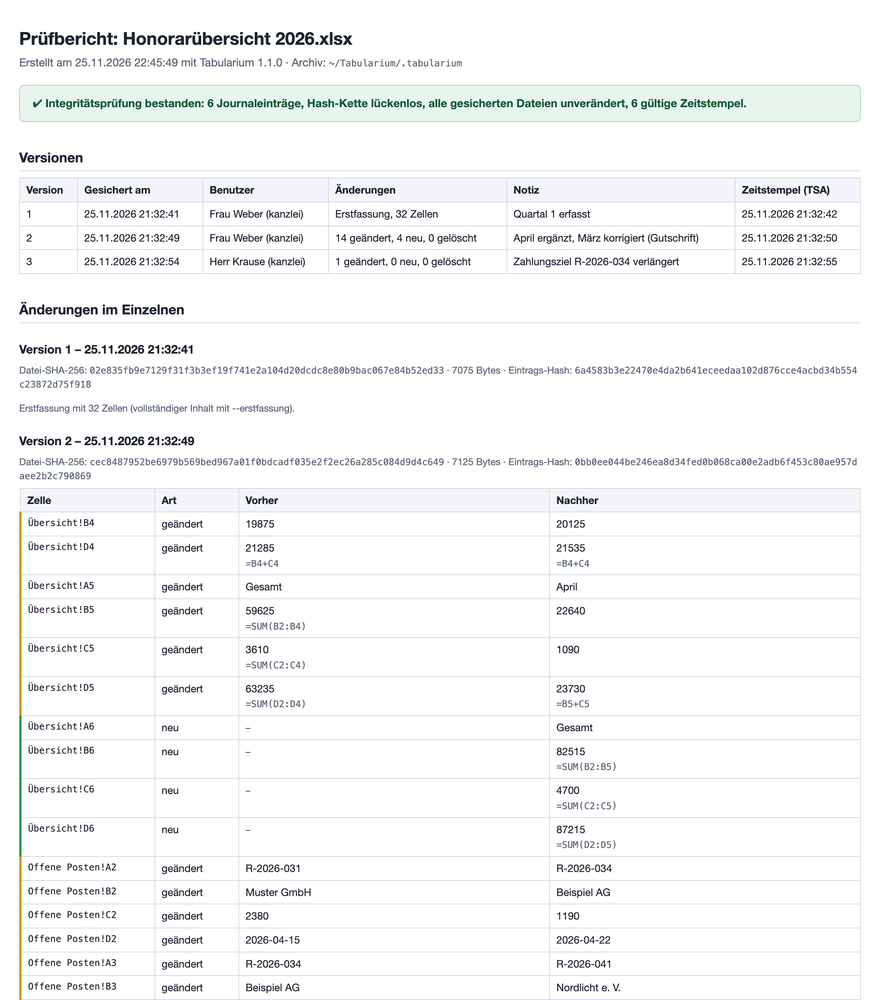

# 6 — Prüfen und Prüfbericht

Ein Archiv ist nur so viel wert wie der Nachweis, dass niemand daran etwas
verändert hat. Dafür gibt es die **Archivprüfung** und den **Prüfbericht**.

## Archiv prüfen

Klicken Sie oben rechts auf **Archiv prüfen**. Nach wenigen Sekunden erscheint
oben ein Ergebnis:

- **Grün, „✔ Archiv unversehrt“:** Alles ist in Ordnung. Darunter steht, wie
  viele Einträge und Zeitstempel geprüft wurden.
- **Rot, „✘ Prüfung fehlgeschlagen“:** Darunter steht jedes gefundene Problem
  mit Dokument und Version.

Die Prüfung umfasst das **ganze Archiv**, nicht nur ein Dokument:

| Was geprüft wird | Erkennt |
| --- | --- |
| Fingerabdruck jedes Journaleintrags | nachträglich geänderte Einträge (Zeitpunkt, Name, Notiz, Prüfwerte) |
| Verkettung mit dem Vorgänger | gelöschte, eingeschobene oder vertauschte Einträge |
| Laufende Nummer und Versionsnummer | Lücken und Doppelungen |
| Fingerabdruck jeder gesicherten Datei | veränderte, ersetzte oder fehlende Originaldateien |
| Fingerabdruck jedes Zellabbilds | veränderte Zellabbilder |
| Jeder Zeitstempel | gefälschte, vertauschte oder ungültige Zeitstempel |

### Was eine rote Meldung bedeutet

| Meldung | Bedeutung |
| --- | --- |
| *Inhalt nachträglich verändert* | Jemand hat den Eintrag im Journal bearbeitet. |
| *Kette unterbrochen* | Davor wurde ein Eintrag entfernt, eingefügt oder geändert. |
| *laufende Nummer … erwartet …* | Ein Eintrag fehlt oder wurde eingeschoben. |
| *gesicherte Datei wurde verändert / fehlt* | Die Originaldatei im Archiv stimmt nicht mehr mit dem Fingerabdruck überein. |
| *Zeitstempel ungültig* | Der Zeitstempel gehört nicht zu diesem Eintrag oder ist beschädigt. |

Eine rote Meldung entsteht nie durch normales Arbeiten mit Tabularium. Sie
bedeutet, dass jemand oder etwas (auch ein defekter Datenträger) die Dateien im
Archiv verändert hat. Fertigen Sie dann sofort einen Prüfbericht an, ändern Sie
nichts mehr und ziehen Sie die IT hinzu. Eine Datensicherung des Archivs hilft
bei der Aufklärung ([Kapitel 10](10-archiv-und-sicherung.md)).

### Der Kopf-Hash

Nach einer erfolgreichen Prüfung nennt Tabularium den **Kopf-Hash**. Das ist
der Fingerabdruck des letzten Journaleintrags, und er schließt die ganze Kette
ein. Notieren Sie ihn oder heben Sie den Prüfbericht auf. Damit erkennen Sie
später auch einen Fall, den die Kette allein nicht zeigt: dass jemand die
**letzten** Einträge entfernt hat. Die Kette davor wäre dann ja weiter
lückenlos. Auf dem Mac verhindert Tabularium das zusätzlich, denn das Journal
lässt sich dort nur ergänzen, nicht kürzen
([Kapitel 10](10-archiv-und-sicherung.md#schutz-auf-dem-mac)).

## Der Prüfbericht

Im Verlauf eines Dokuments öffnet **Prüfbericht** einen Bericht in einem neuen
Tab. Er ist für die Akte, den Mandanten, die Steuerberatung oder ein Gericht
gedacht.



Er enthält:

1. **Prüfergebnis** des ganzen Archivs zum Zeitpunkt des Berichts
2. **Versionen** mit Zeitpunkt, Benutzer, Notiz, Änderungen und dem Zeitpunkt
   laut Zeitstempelstelle
3. **Änderungen im Einzelnen** für jede Fassung, mit Vorher und Nachher und den
   Formeln (bis 1000 Änderungen je Fassung)
4. zu jeder Fassung den **SHA-256 der Datei** und den **Eintrags-Hash**
5. Hinweise zum Prüfverfahren und den **Kopf-Hash**

Werte stehen im Bericht so, wie sie gespeichert sind (etwa `892.5`,
`2026-04-22`). So sind sie eindeutig.

### Als PDF speichern

Im Browser **Drucken** wählen (Mac ⌘P, Windows Strg+P). Auf dem Mac unten links
**PDF → Als PDF sichern**, unter Windows als Drucker **Microsoft Print to PDF**
bzw. **Als PDF speichern**. Der Bericht ist für den Druck gestaltet und bricht
Tabellen sauber um.

> **Tipp für die Akte:** Sichern Sie das PDF mit Datum im Namen, zum Beispiel
> „2026-11-25 Prüfbericht Honorarübersicht.pdf“. Wer den Bericht später erneut
> erzeugt, sieht anhand der Fingerabdrücke, ob sich etwas geändert hat.

### Vollständiger Inhalt der Erstfassung

Für die Erstfassung nennt der Bericht nur die Zahl der Zellen. Brauchen Sie
deren vollständigen Inhalt im Bericht, erzeugen Sie ihn über die
Kommandozeile:

```bash
./tabularium bericht "Honorarübersicht 2026.xlsx" --erstfassung --oeffnen
```

## Für IT: Prüfung automatisieren

`./tabularium pruefen` endet mit Exit-Code **0**, wenn alles in Ordnung ist, und
**2** bei einem Befund. So lässt sich die Prüfung etwa nächtlich per `launchd`
oder `cron` ausführen und bei einem Fehler eine Nachricht auslösen
([Kapitel 9](09-kommandozeile.md)).

---

← [5 — Ordner überwachen](05-ordner-ueberwachen.md) | [Inhalt](README.md) | [7 — Zeitstempel](07-zeitstempel.md) →
